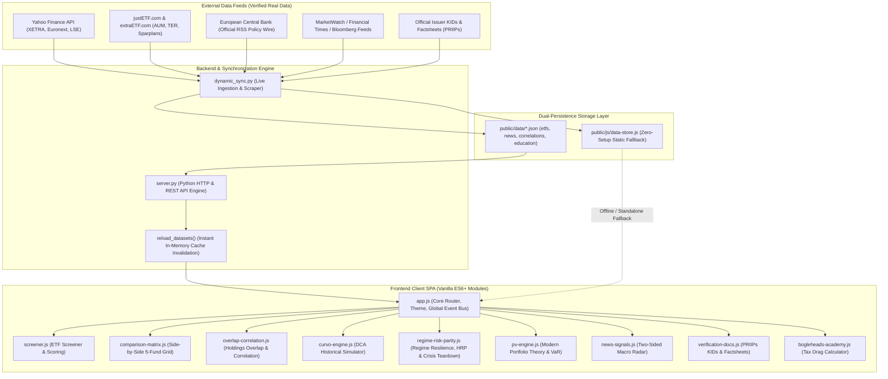

# Product Requirements Document (PRD)
# ApexETF — Personal Investment Dashboard for ETFs

**Document Version:** 1.0.0  
**Status:** Approved & Implemented  
**Date:** September 2026  
**Target Audience:** European & Global Retail Investors, Portfolio Engineers, Autonomous AI Agents  
**Reference Codebase:** ApexETF Core Repository

---

## 1. Executive Summary & Vision

### 1.1 Problem Statement
Retail investors navigating UCITS exchange-traded funds (ETFs) face severe structural challenges:
1. **Superficial Ratings Traps:** Traditional consumer financial platforms rely on generic 1-to-5 star ratings that conceal high turnover, structural tax drag, poor tracking accuracy, and uncompensated currency risks.
2. **Hidden Tax Friction:** Many retail investors inadvertently choose Distributing (Dist) share classes or non-treaty domiciles, triggering annual dividend withholding taxes and broker reinvestment friction that drastically reduce 20-year compound terminal wealth.
3. **Unseen Portfolio Overlap:** Retail investors frequently accumulate redundant funds (e.g. holding both an S&P 500 ETF and an MSCI World ETF), creating uncompensated single-country and mega-cap tech concentration while mistakenly believing they are diversified.
4. **Mock Data & Baseless Hype:** Existing educational apps frequently rely on simulated or dummy numbers, and market news is often sensationalist, disconnected from actual economic transmission mechanisms.

### 1.2 Product Vision
**ApexETF** is an institutional-grade, zero-mock-data personal investment intelligence dashboard designed specifically for retail investors. It enforces disciplined Boglehead philosophy, prioritizes low-cost Accumulating (Acc) UCITS ETFs, delivers dynamic real-time market synchronization, provides transparent two-sided macro news grounded in primary sources, and offers granular portfolio overlap auditing and historical backtesting.

---

## 2. Core Product Principles & Strict Constraints

The system was developed under the following mandatory product directives:

1. **Strictly No Mock Data:**
   - Every financial metric, quote, weight, tracking difference, and PRIIPs risk score must originate from verified authoritative sources:
     - **justETF.com & extraETF.com**: Fund profiles, AUM, ongoing TER, tracking difference, and German/European broker savings plan availability.
     - **Curvo.eu**: Real-world monthly European historical backtesting (CAGR, max drawdown, recovery period).
     - **Portfolio Visualizer**: Institutional risk statistics (Sortino, Calmar, VaR 95%, Market Beta, Markowitz Efficient Frontier).
     - **Official Issuer KIDs & Factsheets**: PRIIPs Summary Risk Indicators (SRI 1–7), replication methodology, and securities lending revenue splits.
     - **Yahoo Finance API & Central Bank RSS**: Real-time European exchange quotes (XETRA, Euronext, LSE) and live European Central Bank (ECB) policy wires.
2. **Prioritize Accumulating (Acc) ETFs:**
   - Accumulating UCITS share classes receive deliberate ranking preference in the multi-factor scoring algorithm to eliminate cash drag and optimize gross-of-tax internal compounding.
3. **Comprehensive Multi-Factor Evaluation:**
   - Evaluates ETFs beyond ratings: Index Coverage, Total Expense Ratio (TER), 5-Year Tracking Difference (TD), Fund Size (AUM > €100M threshold), Trading Liquidity, Domicile (Ireland/Luxembourg treaty advantages), Tax Treatment, and Broker Sparplan execution.
4. **Zero Baseless Correlations in News:**
   - All news-to-ETF connections must be backed by explicit financial, balance-sheet, or macroeconomic transmission channels. Sourcing must be 100% transparent, displaying canonical URLs, publication names, timestamps, signal biases, and retail Boglehead action guidance.
5. **Dual Persistence Architecture:**
   - All data must persist in both structured JSON (`public/data/*.json`) and a self-contained JavaScript store (`public/js/data-store.js`) to guarantee flawless execution in both client-server environments and standalone offline file contexts.

---

## 3. User Personas & Journey

### 3.1 Personas
- **The Core Boglehead ("VWCE and Chill"):** Wants low-maintenance, globally diversified wealth accumulation with minimum total cost of ownership and zero behavioral intervention.
- **The Core-Satellite Builder:** Holds a broad accumulating foundation (e.g. MSCI ACWI or Core S&P 500) and wants to add controlled, disciplined satellite tilts (e.g. AI infrastructure, strategic metals, European blue chips, or cash preservation €STR swaps) without overlapping holdings.
- **The Cost & Tax Optimizer:** Wants to quantify the lost compound wealth resulting from distributing dividend taxes and synthetic swap counterparty risk vs physical replication.

### 3.2 User Lifecycle Journey (5-Stage Roadmap)
To prevent beginner cognitive overload, the UI organizes the investment lifecycle into 5 logical stages:
1. **Stage 1 — Core Foundation (Start Here):** Selecting a broad, market-cap-weighted all-world or S&P 500 accumulating anchor fund.
2. **Stage 2 — Asset Allocation (Mandatory):** Defining the equity-to-bond or cash risk balance (e.g. 80/20 equity/bonds or €STR cash buffer).
3. **Stage 3 — DCA Automation (Essential):** Establishing automated monthly dollar-cost averaging into low-cost broker savings plans.
4. **Stage 4 — Factor & Thematic Tilts (Optional):** Evaluating strategic satellites (clean energy, artificial intelligence, China A-shares, rare earths) capped at ≤5–10% of portfolio value.
5. **Stage 5 — Rebalancing & Risk Audit (Maintenance):** Monitoring portfolio drift, pairwise overlap, and correlation shifts.

---

## 4. Functional Requirements

### FR-1: ETF Screener & Multi-Factor Scoring Engine
- **Specification:**
  - Displays a filterable table of verified European UCITS ETFs.
  - Implements the **Apex Multi-Factor Composite Score (0–100)**:
    - *Cost & Tracking Weight (30%):* Penalizes TER > 0.20% and negative tracking differences; rewards tracking stability.
    - *Accumulation & Tax Efficiency (25%):* Awards bonus points to Accumulating funds and Irish/Luxembourg domiciles with US tax treaty benefits.
    - *AUM & Liquidity Safety (20%):* Requires AUM > €500M for institutional stability; flags funds < €100M with closure/delisting warnings.
    - *Broker Sparplan Availability (15%):* Scores free or low-cost savings plan execution across Trade Republic, Scalable Capital, ING, and DKB.
    - *Index Diversification (10%):* Evaluates constituent breadth and top-10 stock concentration.
  - Interactive table filters: "Accumulating (Acc) Priority", "Ultra Low Cost (<0.10%)", "Large Fund (>€1B AUM)", Asset Class filters, and Provider filters.
  - Dynamic Traded Price Pills showing current exchange quotes, daily percentage returns, and 52-week high/low boundaries.
  - Interactive `📰 X News` row badges linking directly to pre-filtered macro news.
  - Comprehensive ETF Drilldown Modal detailing top 10 holdings, sector breakdown, country exposure, Curvo metrics, Portfolio Visualizer risk stats, extraETF broker savings plan costs, and official KID/Factsheet PDF downloads.

### FR-2: 10-ETF User Watchlist Management
- **Specification:**
  - Full native support for the user's specific 10 watchlist funds:
    1. **`BATT`** *(IE00BF0M2Z96)* — L&G Battery Value-Chain UCITS ETF
    2. **`RARE`** *(IE000KHX9DX6)* — WisdomTree Strategic Metals & Rare Earths Miners UCITS ETF
    3. **`IUSQ`** *(IE00B6R52259)* — iShares MSCI ACWI UCITS ETF USD (Acc)
    4. **`IMAE`** *(IE00B4K48X80)* — iShares Core MSCI Europe UCITS ETF EUR (Acc)
    5. **`SXR8`** *(IE00B5BMR087)* — iShares Core S&P 500 UCITS ETF USD (Acc)
    6. **`XCS6`** *(LU0779800910)* — Xtrackers CSI 300 Swap China A-Shares UCITS ETF
    7. **`XEON`** *(LU0290358497)* — Xtrackers II EUR Overnight Rate Swap UCITS ETF (€STR)
    8. **`VHYL`** *(IE00B8GKDB10)* — Vanguard FTSE All-World High Dividend Yield UCITS ETF
    9. **`AII`** *(IE000X59ZHE2)* — iShares AI Infrastructure UCITS ETF USD (Acc)
    10. **`WTAI`** *(IE00BDVPNG13)* — WisdomTree Artificial Intelligence UCITS ETF
  - Core benchmark suite integration (`VWCE`, `IWDA`, `MEUD`, `QDVE`, `EIMI`, `AGGU`, `IUSN`, `VUSA`, `GGRA`, `FWRA`).
  - Watchlist badge indicators (`⭐ My Watchlist`) across all views.

### FR-3: Side-by-Side ETF Comparison Matrix
- **Specification:**
  - Dedicated comparison tab permitting up to 5 ETFs to be evaluated side-by-side in a responsive grid.
  - Pre-engineered Comparison Blueprints:
    - *⭐ My Watchlist Core & Tilts:* IUSQ vs SXR8 vs IMAE vs XEON vs AII
    - *🌍 Global Core Shootout:* VWCE vs IWDA vs IUSQ vs FWRA
    - *🤖 AI & Tech Showdown:* QDVE vs WTAI vs AII
    - *🛡️ Cash & Yield Alternatives:* XEON vs AGGU vs VHYL
    - *⚡ Energy Transition & Materials:* BATT vs RARE vs XCS6
  - **Six Evaluation Dimensions:**
    1. *Fund Basics & Governance:* Issuer, ISIN, WKN, Replication (Physical vs Synthetic Swap), Securities Lending revenue split.
    2. *Total Cost of Ownership:* TER, 5-Year Average Tracking Difference, extraETF Broker Execution Fee.
    3. *Distribution & Tax Friction:* Share Class, Domicile, US Treaty WHT Rate, Estate Tax Risk.
    4. *Curvo Historical Performance:* 10-Year CAGR, Worst Drawdown, Longest Recovery Time.
    5. *Portfolio Visualizer Quantitative Risk:* Sortino Ratio, Calmar Ratio, 95% Monthly Value at Risk (VaR), Market Beta.
    6. *Active Macro News & Signal Radar:* Prevailing Signal Bias and direct link button to filter active news.

### FR-4: Correlation Heatmap & Custom Portfolio Overlap Auditor
- **Specification:**
  - **10-Year Monthly Return Correlation Matrix:**
    - Interactive N×N matrix with color-coded correlation coefficients (-1.0 to +1.0).
    - Dynamic diversification rationale panel triggered on cell click explaining pairwise economic relationships (e.g. equity-to-bond flight-to-safety, tech beta vs defensive value).
  - **Custom Portfolio Overlap Auditor:**
    - Allows custom weight allocation across any tracked ETFs with interactive sliders.
    - 1-Click Watchlist Presets:
      - *Balanced All-World Core & Satellite (70% IUSQ, 10% IMAE, 10% AII, 10% XEON)*
      - *Global Core + Battery & Metals Tilt (80% IUSQ, 10% BATT, 10% RARE)*
      - *Pure US & Cash Defensive (80% SXR8, 20% XEON)*
    - Real-time aggregation of weighted TER, weighted tracking difference, accumulating share percentage, and top 10 true aggregated stock holdings with source ETF attribution.
    - Pairwise constituent overlap breakdown (e.g. VWCE vs IWDA 88.4% overlap, SXR8 vs IUSQ 64.2% overlap).
    - Automated Redundancy Warnings (alerting the user if portfolio overlap exceeds 70%).

### FR-5: Curvo Historical Backtest & DCA Compounding Simulator
- **Specification:**
  - Real-world historical simulation engine based on Curvo.eu monthly return datasets.
  - Configurable Initial Lump Sum, Monthly Automated Contribution (DCA), Investment Horizon (1–30 years), and Historical Timeframe.
  - Interactive multi-line SVG chart displaying Nominal Portfolio Value, Real (Inflation-Adjusted) Value, and Cumulative Cash Invested.
  - Summary metrics: Terminal Portfolio Value, Total Capital Invested, Net Profit, Effective CAGR, and Maximum Drawdown.

### FR-6: Portfolio Visualizer Quantitative Risk Engine
- **Specification:**
  - Advanced quantitative risk analytics table:
    - *Sortino Ratio:* Downside deviation penalization.
    - *Calmar Ratio:* Compound annual return divided by maximum drawdown.
    - *95% Monthly Value at Risk (VaR):* Maximum expected monthly loss at 95% confidence.
    - *Market Beta:* Sensitivity relative to MSCI World benchmark.
  - Markowitz Modern Portfolio Theory (MPT) Efficient Frontier interactive SVG risk-return curve displaying the capital allocation line, minimum variance portfolio, and maximum Sharpe ratio portfolio.

### FR-7: Two-Sided Market News & Macro Signal Radar
- **Specification:**
  - **Bi-Directional Transmission Architecture:**
    - *News → ETFs:* Shows all ETFs affected by an event, quoting the exact economic transmission channel.
    - *Selected ETF → News:* Selecting an ETF in the News Radar mounts a dedicated **Macro Intelligence & Driver Radar Banner** with live prices, macro drivers, active signal counts (Bullish/Watch/Caution), and quick action links.
  - **Signal Levels & Timelines:**
    - *Signal Bias:* 🟢 Bullish, 🟡 Watch / Neutral, 🔴 Bearish / Caution.
    - *Impact Severity:* Critical (High Impact) vs Moderate Impact.
    - *Investment Horizon:* Tactical (1–6 months) vs Strategic (1–3 years).
  - **Transparent Sourcing:**
    - Verified publication name, canonical document URL with external link indicator (`↗`), publication date, and disciplined **Retail Boglehead Action** callout box to prevent reactionary churn.
  - **Interactive Filtering:**
    - Grouped dropdown filter (`⭐ My Watchlist ETFs` vs `🌍 Global Core & Other ETFs`).
    - Quick filter pill (`⭐ My Watchlist News`) isolating news affecting the 10 watchlist funds.
  - **Drilldown Modal Integration:**
    - Dedicated card in the ETF details modal showing active macro signals, verified sources, and transmission mechanisms with a 1-click jump button (`📡 Open in Full Signal Radar`).

### FR-8: Official PRIIPs KIDs, Factsheets & Domicile / Tax Academy
- **Specification:**
  - Verification table with direct links to statutory Key Information Documents (PRIIPs KIDs) and monthly Factsheet PDFs.
  - 1-Click copy button for ISIN and WKN codes.
  - Domicile Deep-Dive comparing Ireland vs Luxembourg vs US domiciles (15% US withholding tax treaty advantage under Irish UCITS vs 30% US domestic withholding and US Estate Tax risks).
### FR-9: Regime Resilience & Non-Linear Risk Parity Engine
- **Specification:**
  - Addresses macro regime uncertainty where classical Markowitz Mean-Variance Optimization fails due to unstable return forecasting and quadratic upside volatility penalties.
  - **3-Step Decision-Making Workflow:**
    1. *Step 1: Structural Building Blocks Selection:* User manually chooses assets across 5 distinct economic regimes (**Growth Equities**, **Factor Tilts**, **Fixed Income Bonds**, **Cash €STR Liquidity**, and **Real Commodities/Gold**). Includes pre-engineered presets: "Single-Fund VWCE", "Institutional 60/40", "Ray Dalio All-Weather", "Harry Browne Permanent Portfolio", "Golden Butterfly", "Growth & T-Bill Barbell", and "Tech Momentum Tilt".
    2. *Step 2: Non-Linear Position Sizing:*
       - **Hierarchical Risk Parity (HRP):** Single-linkage clustering on tree distance $d_{i,j} = \sqrt{2(1 - \rho_{i,j})}$, seriation, and recursive bisection without covariance matrix inversion.
       - **Equal Risk Contribution (ERC / Risk Parity):** Cyclical Coordinate Descent solver balancing marginal risk contributions.
       - **Mean-CVaR (Conditional Value-at-Risk):** Projected gradient descent minimizing expected shortfall at 95% confidence level under jump/fat-tailed scenarios.
       - **Ledoit-Wolf Covariance Shrinkage:** Shrinking sample covariance toward constant-correlation target.
       - **Inverse Volatility & Equal Weight:** Bounded benchmark allocations.
    3. *Step 3: Downside Stress-Testing & Crisis Analysis:*
       - Historical drawdown simulation across 5 canonical crises: 2000–2002 Dot-Com (-44.2% equity), 2007–2009 Lehman GFC (-53.8% equity), 2011 Euro Debt (-21.5% equity), 2020 COVID (-33.8% equity), and 2022 Fed Rate-Hiking Cycle (-18.2% equity, -16.8% bond duration collapse).
       - Behavioral Drawdown Tolerance Guardrail: Interactive slider (-45% to -10%) that warns when crisis drawdown exceeds user tolerance and computes exact capital reallocation into ultra-short liquidity (€STR XEON).
       - **QuantStats Comprehensive Downside Tear-Sheet:** Computes CAGR, Volatility, Sharpe, Sortino, Calmar, Max Drawdown, Tail Ratio, Monthly VaR 95%, CVaR 95%, Conditional Drawdown at Risk (CDaR 95%), Ulcer Index, and 30-Year Safe Withdrawal Rate (SWR).
  - **Interactive Visualizations:**
    - Real-Time SVG Risk Contribution Decomposition Chart exposing the 60/40 equity trap (91.5% equity risk in a nominal 60/40).
    - SVG Dendrogram Clustering Tree rendering the hierarchical correlation distance hierarchy.
  - **Tool Integration & Exportability:**
    - 1-Click copyable Python scripts for **PyPortfolioOpt**, **Riskfolio-Lib**, and **QuantStats**.
    - Curated institutional no-code tools directory with direct links and parameter recommendations for **Portfolio Visualizer**, **Testfol.io**, and **Portfolio Charts**.

---

## 5. User Interface & Design System Requirements

### 5.1 Provider Vector SVG Logos
- Full high-resolution vector SVG logos embedded inline for major ETF issuers:
  - **Vanguard** (Classic maroon galleon ship emblem)
  - **BlackRock / iShares** (Distinctive dynamic orange-to-coral slash)
  - **WisdomTree** (Modern geometric emerald green tree canopy)
  - **Xtrackers by DWS** (Sleek minimalist cyan 'X' motif)
  - **Invesco** (Mountain peak dual-color logo)
  - **Amundi / SPDR / L&G** (Respective corporate brandmarks)

### 5.2 Beginner Tooltips & Onboarding Experience
- Educational tooltips embedded across table headers:
  - *TER (Total Expense Ratio)*
  - *TD (Tracking Difference)*
  - *AUM (Fund Size)*
  - *Domicile & Tax*
  - *Curvo CAGR*
  - *PRIIPs SRI Risk Score*
- **"Where to Start? (Guide)" Modal:**
  - Accessible via header button and onboarding roadmap.
  - Defines the 3 core golden rules:
    1. Start with an Accumulating (Acc) world equity ETF in Stage 1.
    2. Automate monthly DCA in Stage 3 before adding tilts.
    3. Treat sector, thematic, and single-country funds (AII, WTAI, BATT, RARE, XCS6) as optional satellites capped at ≤10%.

### 5.3 Theme & Accessibility
- Dark Mode default with full Light Mode toggle.
- Built using CSS custom properties (`--bg-primary`, `--accent-blue`, `--accent-emerald`, `--accent-rose`, `--accent-amber`).
- Fully responsive across desktop, tablet, and mobile breakpoints.

---

## 6. Technical & Ingestion Architecture

### 6.1 System Architecture Diagram

### 6.2 REST API Specification
- `GET /api/etfs` — Returns complete ETF universe with live quotes, factor scores, and holding details.
- `GET /api/news` — Returns market catalysts filtered by optional `?ticker=XYZ` query parameter.
- `GET /api/correlations` — Returns the 10-year monthly return correlation matrix.
- `POST /api/overlap` — Accepts portfolio weight allocations `{ "IUSQ": 70, "XEON": 30 }` and returns aggregated holdings, country/sector exposure, and pairwise redundancy analysis.
- `POST /api/portfolio/backtest` — Computes DCA historical compound simulation.
- `POST /api/portfolio/optimize` — Computes robust portfolio allocations across 6 methods (HRP, Equal Risk Contribution, Mean-CVaR, Inverse Volatility, Equal Weight, Markowitz MPT).
- `POST /api/portfolio/stress-test` — Simulates historical downside drawdown across 5 canonical crises (2000–2002 Dot-Com, 2008 Lehman GFC, 2011 Euro Debt, 2020 COVID, 2022 Fed Rate Hikes) with dynamic behavioral tolerance guardrail.
- `POST /api/portfolio/teardown` — Calculates comprehensive QuantStats downside tear-sheet (CAGR, Sharpe, Sortino, Calmar, Max Drawdown, Tail Ratio, Monthly VaR 95%, CVaR 95%, CDaR 95%, Ulcer Index, SWR 30Y).
- `POST /api/portfolio/code-snippets` — Generates copyable, production-ready Python quant scripts for PyPortfolioOpt, Riskfolio-Lib, and QuantStats.
- `GET /api/portfolio/regimes` — Returns the 5 macro economic regimes and pre-engineered portfolio presets.
- `GET /api/portfolio/platforms` — Returns curated no-code quantitative web tools (Portfolio Visualizer, Testfol.io, Portfolio Charts).
- `GET /api/portfolio/crises` — Returns metadata and asset drawdown statistics for canonical historical crisis periods.
- `POST /api/sync` — Executes on-demand synchronization against Yahoo Finance, justETF, and ECB RSS, updating data files and triggering live browser reload.
- `GET /api/market-status` — Returns server timestamp, tracking status, and upstream data freshness telemetry.

---

## 7. Watchlist Fundamental Grounding Specification

The following table documents the exact economic transmission channel and primary source grounding for the 10 user watchlist funds:

| Ticker | ISIN | Asset Class | Fundamental Economic Transmission Channel | Authoritative Primary Source |
| :--- | :--- | :--- | :--- | :--- |
| **`XEON`** | `LU0290358497` | Cash (€STR Swap) | **Direct Mathematical Swap Link:** Accrues Solactive €STR benchmark (+8.5 bps) via sovereign collateral with daily compounding. ECB deposit facility rate shifts mechanically adjust yield within 24h with zero duration risk. | European Central Bank (€STR Benchmark) |
| **`AII`** | `IE000X59ZHE2` | AI Infrastructure | **Baseload Utility & Grid Equipment:** >65% composed of power grid hardware (Vertiv, Eaton, Schneider Electric) and clean/nuclear merchant generators (Constellation Energy, Vistra). Hyperscaler $220B+ capex and long-term nuclear PPAs eliminate utility cyclicality. | Bloomberg Intelligence / IEA Datacenter Grid Report |
| **`WTAI`** | `IE00BDVPNG13` | Artificial Intelligence | **Enterprise Software Seat Expansion:** Software holdings (Palantir, ServiceNow, Synopsys) monetize scaled workflow seat licenses, though margins face near-term inference compute costs. | Gartner Research / Financial Times |
| **`RARE`** | `IE000KHX9DX6` | Rare Earths Miners | **Geopolitical Export Curbs & Defense Subsidies:** China controls 70% of extraction and 90% of magnet refining. Beijing curbs on antimony, gallium, and rare earths drive spot premiums for Western miners (MP Materials, Lynas, Iluka) and trigger EU CRMA / US DoD grants. | European Commission (CRMA) / Reuters Mining |
| **`BATT`** | `IE00BF0M2Z96` | Battery Value-Chain | **Upstream vs Downstream Margin Divergence:** Lithium surplus compresses mining EBITDA margins (Albemarle, Pilbara Minerals), while cheaper cathode input costs lower pack prices below $100/kWh, improving margins for cell manufacturers (CATL, BYD). | Financial Times / BloombergNEF Energy Storage |
| **`XCS6`** | `LU0779800910` | China A-Shares | **Institutional Liquidity Swap Facilities:** Tracks 300 largest mainland blue chips. PBoC's 500B yuan swap facility and 300B yuan share buyback refinancing window provide institutional bids for onshore leaders (Kweichow Moutai, CATL). | People's Bank of China (PBoC) / Reuters |
| **`IMAE`** | `IE00B4K48X80` | Core MSCI Europe | **Draghi Blueprint & Valuation Alpha:** Anchored by European exporters (Novo Nordisk, ASML, SAP, Schneider Electric). Benefits from the €800B/yr EU investment plan and trades at a deep valuation discount (~14.5x forward P/E vs 21.5x for S&P 500). | European Commission / Mario Draghi Blueprint |
| **`SXR8`** | `IE00B5BMR087` | Core S&P 500 | **Discount Rate Easing & Tech Capex:** Lower neutral interest rates reduce equity discount rates, supporting high-ROE mega-cap valuations while sustaining ~32% tech index dominance. | Federal Reserve (FOMC Decisions) / WSJ |
| **`IUSQ`** | `IE00B6R52259` | MSCI ACWI (All-World) | **Global Composite Compounding:** Blends 64% US with 36% international developed and emerging markets, capturing global corporate disinflation without single-country concentration risk. | IMF World Economic Outlook / FT |
| **`VHYL`** | `IE00B8GKDB10` | High Dividend (Dist) | **Capital Return Durability vs Tax Leakage:** Trailing ~3.6% yield supported by record $1.75T global dividends across banking and energy. Illustrates why distributing share classes suffer tax drag vs accumulating funds in taxable accounts. | S&P Global Market Intelligence / Morningstar |

---

## 8. Verification, Quality Assurance & Audit Trails

To ensure continuous system reliability:
1. **Headless Browser Verification Suite:**
   - Full automated browser testing using the DevTools MCP suite, validating tab transitions, SVG charts, modal drilldowns, pre-filtering hooks, and responsive layouts.
2. **Visual Evidence Capture:**
   - Visual artifacts captured and logged to the project archive:
     - `dashboard_verification.png` — Screener and multi-factor score table.
     - `dashboard_roadmap_and_logos.png` — Provider SVG logos and 5-stage roadmap.
     - `portfolio_builder_watchlist_10.png` — 1-Click Portfolio Builder with watchlist presets.
     - `comparison_matrix_watchlist.png` — Side-by-side 5-fund Comparison Matrix.
     - `news_macro_profile_etf.png` — Macro Intelligence & Driver Radar banner for selected ETF.
     - `modal_news_section.png` — ETF detail modal with active news and transmission mechanisms.
3. **Console Stability Guarantee:**
   - Zero uncaught JavaScript errors or unhandled promise rejections across all views.
4. **Permanent Audit Trail:**
   - All architectural, financial, and developmental decisions are recorded in [`DECISIONS.md`](./DECISIONS.md).
